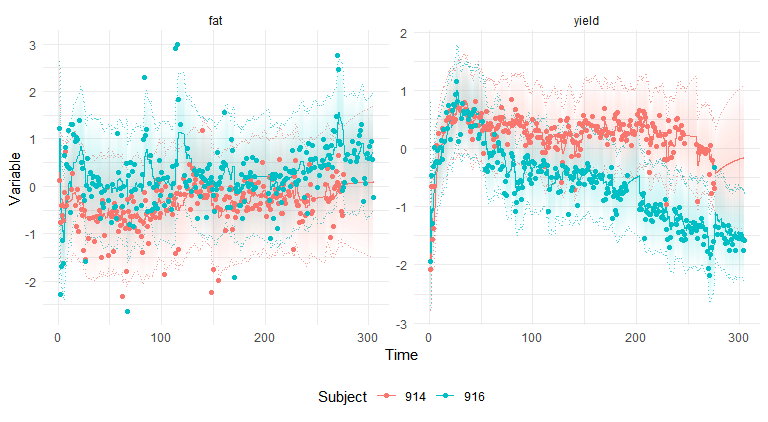
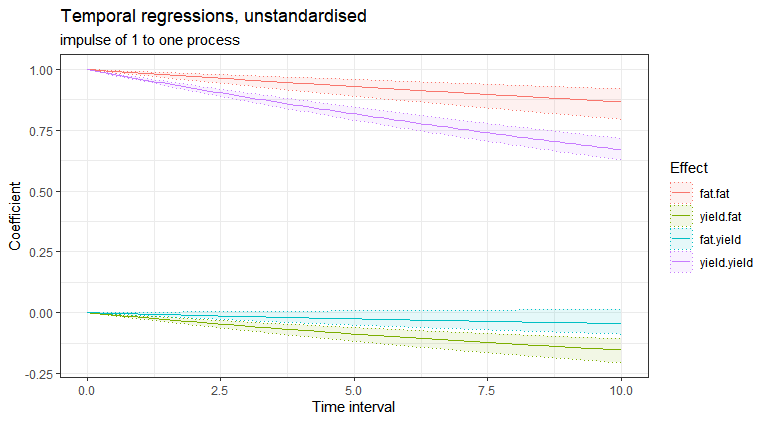
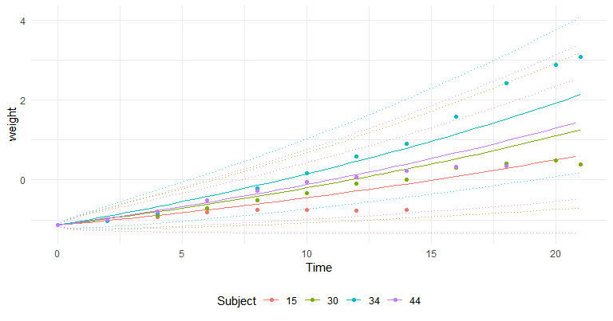
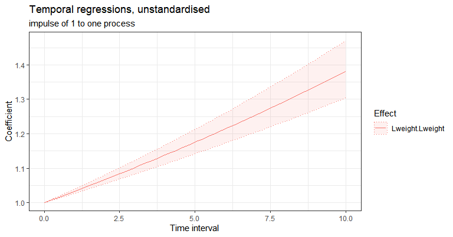

<!-- README.md is generated from README.rmd -- edit README.rmd, then re-knit with
     rmarkdown::render('README.rmd'). The example chunks are EVALUATED against the
     installed ctsem, so install the package before knitting. Write plain markdown
     here: LaTeX (\url{}) and roxygen (#') markup do not survive the conversion.
     The timings quoted near the top, and in NEW-IN-4.md, were measured
     separately, not by knitting; when they are measured again, say where and
     when, as they do now. -->

# ctsem

<!-- badges: start -->

[](https://github.com/cdriveraus/ctsem/actions)
[](https://cran.r-project.org/package=ctsem)
[](https://cran.r-project.org/package=ctsem)
<!-- badges: end -->

ctsem fits continuous and discrete time state space models to
longitudinal data. A system of stochastic differential equations (or
difference equations, in discrete time) describes how a set of latent
processes change and affect each other, and a measurement model links
those processes to the observed variables. Panel data with a few waves,
intensive longitudinal data with hundreds of observations per person,
and single long time series all use the same interface, and observation
times can be irregular and different for every person.

Version 4 fits with a new engine written in Julia by default. For what
changed since 3.x, see [New in 4.x](NEW-IN-4.md).

## What it covers

- **Dynamics.** Several interacting processes, higher order dynamics
  such as damped oscillation, time dependent inputs and interventions,
  and parameters that depend on the latent state (nonlinear dynamics).
  Latent growth curves, latent change scores and the cross-lagged panel
  model are special cases.
- **Measurement.** Several indicators per process, as in dynamic factor
  analysis. Indicators can be continuous, binary, ordinal, counts or
  censored, mixed within one model, and loadings, intercepts and error
  variances can depend on the latent state.
- **Individual differences.** Any parameter can vary between people, or
  at several nested levels such as people within couples, and depend on
  time independent covariates, linearly or as a smooth function. Random
  effects are integrated out by a Laplace approximation, exactly
  wherever they shift a mean in a linear Gaussian model, and each fit
  checks the approximation’s error for every person and warns where it
  would change the estimates.
- **Estimation and uncertainty.** Maximum likelihood, or maximum a
  posteriori with priors, using exact gradients; standard errors from
  the Hessian along with a check of the normal approximation; or
  sampling of the full posterior, random effects included.
- **Speed.** On one core, the first example below fits in 18 seconds
  with the Julia engine and 56 with Stan, and a simulated panel of 400
  people with 40 observations each in 18 against 47, each pair reaching
  the same maximum ([timings](NEW-IN-4.md#timings): one AMD EPYC 9654
  server, November 2026).
- **Threads.** The likelihood, its gradient and the Hessian are computed
  in parallel over subjects within one process, so `cores` speeds up a
  single fit. With random auto-effects added to that panel, a fit took
  637 seconds on one core, 173 on four and 60 on sixteen.
- **No compiling per model.** The engine is compiled once, the first
  time it is used after installing. A nonlinear version of the first
  example then fitted in 64 seconds in a new R session, while Stan spent
  about six minutes compiling the same model, in every new session,
  before a 76 second fit.
- **Checking and building models.** Score tests for what a model leaves
  out, tests of its one-step-ahead prediction errors, cross validation,
  identification checks before fitting, and a step-by-step model search.
  `ctReport()` runs the reporting and checking functions over a fit and
  writes the results to a folder.

## Install

``` r
install.packages('ctsem')    # the released version, from CRAN

# or the development version, which is what this page describes
remotes::install_github('cdriveraus/ctsem',
  INSTALL_opts = "--no-multiarch", dependencies = c("Depends", "Imports"))
```

Then, once:

``` r
library(ctsem)
ctJuliaInstall()
```

`ctJuliaInstall()` installs whatever is missing: Julia itself, the
JuliaConnectoR package that links it to R, and the engine’s Julia
packages. It asks before each download. The first fit after installing
or updating ctsem builds a compiled image of the engine, which takes
several minutes; after that each R session starts the engine in a few
seconds. `ctJuliaStatus()` reports what was found.

Without Julia, `ctFit(..., backend = 'stan')` fits with Stan as ctsem
3.x did, but most of what is new in version 4 needs the Julia engine.

<details>

<summary>

<b>Compile problems on Windows (rstan / Rtools)</b>
</summary>

Installing from GitHub compiles ctsem’s Stan models, and with
`backend = 'stan'` a nonlinear model is compiled before it is fitted.
Both need a working C++ toolchain. Ensure a recent R and a matching
Rtools are installed, and check that `rstan` itself works before
suspecting ctsem.

Put this single line in `~/.R/Makevars.win`, deleting any other lines:

    CXX17FLAGS += -mtune=native -Wno-ignored-attributes -Wno-deprecated-declarations

If you see errors like `g++ not found`, install devtools, which brings
the toolchain checks with it:

``` r
install.packages('devtools')
```

For anything else compiler related, the Stan forums are the best place
to look: <https://discourse.mc-stan.org/>.

</details>

## A first model

Two coupled processes, densely measured. `milkman_rdm1` in the
[doBy](https://cran.r-project.org/package=doBy) package records daily
milk yield and fat percentage through a full lactation for 53 dairy
cows, a median of 230 observations each. That density is what makes
individual differences in the dynamics estimable at all, rather than
only differences in level.

``` r
library(ctsem)
data(milkman_rdm1, package = 'doBy')

milk <- data.frame(
  cow   = milkman_rdm1$cowno,
  day   = milkman_rdm1$dfc,                     # days since calving
  yield = as.numeric(scale(milkman_rdm1$my)),
  fat   = as.numeric(scale(milkman_rdm1$fatpct)))

model <- ctModel(
  type = 'ct',                        # 'dt' for the discrete time equivalent
  LAMBDA = diag(2),                   # two processes, one indicator each
  manifestNames = c('yield', 'fat'),
  latentNames = c('yield', 'fat'),
  time = 'day',
  id = 'cow')

fit <- ctFit(milk, model)
```

Nothing there is constrained. `LAMBDA` is the factor loading matrix
linking latent processes to observed variables, and its dimensions are
what tell ctsem the system has two processes with one indicator each.
Every other matrix – the auto and cross effects, the system noise and
its correlation, the measurement error, the initial states – takes a
default and is freely estimated, with individual differences where
ctsem’s defaults put them. Scaling the two variables, as above, makes
for easier estimation and more sensible default priors.

``` r
summary(fit)$popmeans
#>                   mean    sd   2.5%    50%  97.5%   mode
#> T0m_yield       -0.936 0.144 -1.220 -0.937 -0.661 -0.943
#> T0m_fat          0.144 0.203 -0.253  0.141  0.559  0.150
#> drift_yield     -0.041 0.004 -0.050 -0.040 -0.033 -0.041
#> drift_yield_fat -0.020 0.004 -0.028 -0.020 -0.013 -0.020
#> drift_fat_yield -0.006 0.004 -0.013 -0.006  0.001 -0.006
#> drift_fat       -0.015 0.004 -0.025 -0.015 -0.009 -0.015
#> diff_yield       0.136 0.004  0.128  0.136  0.143  0.136
#> diff_fat_yield  -0.592 0.061 -0.709 -0.592 -0.464 -0.592
#> diff_fat         0.116 0.005  0.107  0.116  0.125  0.116
#> mvaryield        0.329 0.003  0.323  0.328  0.334  0.328
#> mvarfat          0.582 0.005  0.573  0.582  0.591  0.582
#> mm_yield        -0.058 0.123 -0.281 -0.064  0.190 -0.054
#> mm_fat           0.146 0.113 -0.063  0.146  0.362  0.142
```

Drift names read as `drift_<affected>_<predictor>`, so `drift_yield` is
yield’s own auto effect and `drift_yield_fat` is the effect of fat on
yield. A negative auto effect pulls a process back toward its
equilibrium and its size sets how fast. `diff_yield` and `diff_fat` are
the system noise standard deviations, and `diff_fat_yield` sets the
correlation between them: with two processes it is the correlation’s
Fisher z, so the estimate here is a correlation of -0.53. `mvar*` are
the measurement error standard deviations, and `T0m_*` the mean initial
states.

The two cross effects are not symmetric: a high fat percentage predicts
a subsequent fall in yield, and the interval for `drift_yield_fat`
excludes zero, while the interval for the reverse effect does not.

``` r
summary(fit)$popsd
#>            mean    sd  2.5%   50% 97.5%  mode
#> T0m_yield 0.901 0.121 0.681 0.896 1.172 0.892
#> T0m_fat   1.154 0.152 0.878 1.141 1.470 1.149
#> mm_yield  0.748 0.108 0.563 0.740 0.979 0.742
#> mm_fat    0.433 0.268 0.111 0.366 1.185 0.366
```

Those are the population standard deviations of the parameters that vary
by cow. ctsem’s defaults put random effects on the initial state and the
observation intercept; adding `indvarying` to a parameter’s
specification puts them elsewhere, on an auto effect or a cross effect,
which is what the density of this data buys.

To read the model as equations rather than as code,
`ctModelLatex(model)` renders it to pdf or png.

``` r
ctPredict(fit, subjects = unique(milk$cow)[1:2], plot = TRUE)
```



Points are the observations, lines the model’s expectation for each cow,
and the bands its uncertainty. The rise and slow decline in yield is the
lactation curve, which the model is picking up as a long deviation from
equilibrium rather than as a trend term.

``` r
ctDiscretePars(fit, plot = TRUE)
```



This last plot is the thing continuous time gives you. The same
estimated system is expressed as regression coefficients at every
interval between observations, instead of only at the one interval a
discrete time model happens to be fitted at. Over the ten days shown,
the effect of fat on yield keeps accumulating while the reverse effect
stays flat and near zero.

## Covariate effects on parameters

Something closer to real use: chick growth under four diets, asking
whether diet moves a parameter of the process rather than only the
observed mean. `ChickWeight` is in base R.

``` r
chickdata <- ChickWeight
# Diet is categorical, so it needs dummy / 'one hot' coding.
chickdata <- cbind(chickdata, model.matrix(~ Diet - 1, chickdata))
colnames(chickdata)[5:8] <- paste0('Diet_', 1:4)
# Scaling continuous variables makes for easier estimation and more sensible
# default priors. Time intervals can benefit too.
chickdata$weight <- scale(chickdata$weight)
head(chickdata, 3)
#>       weight Time Chick Diet Diet_1 Diet_2 Diet_3 Diet_4
#> 1 -1.1230637    0     1    1      1      0      0      0
#> 2 -0.9964315    2     1    1      1      0      0      0
#> 3 -0.8838695    4     1    1      1      0      0      0
```

``` r
m <- ctModel(
  type = 'ct',
  LAMBDA = diag(1),
  manifestNames = 'weight',
  latentNames = 'Lweight',
  time = 'Time',
  id = 'Chick',
  DRIFT = 'a11, transform=param',              # lift the usual sign restriction
  MANIFESTMEANS = 0,                           # identification: fix one of
  CINT = 'cint, tipreds=c(Diet_2,Diet_3,Diet_4)',   # these two, estimate the other
  TIpredNames = paste0('Diet_', 2:4),          # diet 1 is the baseline
  tipredDefault = FALSE)                       # only the effects asked for

f <- ctFit(chickdata, m, priors = TRUE)
```

Priors are used here because the model is only weakly identified by
these data without them: growth over a dozen observations does not pin
down an auto effect and a continuous intercept independently.

Two pieces of syntax recur everywhere and are worth unpacking:

- **A string is a free parameter, a number is a fixed value.** The
  observation intercept and the process intercept cannot both be free –
  they describe the same level – so `MANIFESTMEANS = 0` is what lets
  `CINT` be estimated.

- **A parameter carries options after its name, as named fields.** The
  fields are `transform`, `indvarying` (random effects), `sdscale` (the
  random effect sd prior relative to the mean’s) and `tipreds`
  (covariate effects); anything not named takes its default. So
  `'cint, tipreds=c(Diet_2,Diet_3,Diet_4)'` is a parameter named `cint`,
  default in every other respect, moderated by three columns.

  The same cell can be written positionally, with `|` separating the
  fields in that order: `'cint ||||Diet_2,Diet_3,Diet_4'` builds an
  identical model. That is the form the manual and older code use, and
  `ctPar()` writes it for you from named arguments.

``` r
summary(f)$tipreds
#>                  mean    sd   2.5%   50% 97.5%  mode     z
#> tip_Diet_2_cint 0.021 0.013 -0.003 0.021 0.046 0.021 1.621
#> tip_Diet_3_cint 0.050 0.013  0.024 0.050 0.074 0.051 3.908
#> tip_Diet_4_cint 0.028 0.013  0.002 0.028 0.053 0.028 2.171
```

Diets 3 and 4 raise the continuous intercept clearly; diet 2 is not
distinguishable from the baseline diet.

``` r
# One chick per diet, predicted from the covariates alone rather than from data.
ctPredict(f, plot = TRUE, removeObs = TRUE, polygonalpha = 0,
  subjects = as.numeric(chickdata$Chick[!duplicated(ChickWeight$Diet)]))
```



``` r
# Temporal regression coefficients as a function of the time interval.
ctDiscretePars(f, plot = TRUE)
```



Because the sign restriction on the auto effect was lifted, the
coefficient rises above one as the interval grows: an increase in weight
promotes further increase, which is what growth looks like in this
parameterisation.

## Where to go next

| If you want to | Read |
|----|----|
| Know what changed since ctsem 3.x | [New in 4.x](NEW-IN-4.md) |
| Understand what a dynamic system is, and why it is worth the trouble | [Dynamic systems modeling in psychology](https://cdriver.netlify.app/post/introtodynamics/) |
| Work an applied example end to end, from theory through simulation to fitting and checking | the [tutorial preprint](https://osf.io/preprints/psyarxiv/4q9ex_v3), with code and materials in the [OSF project](https://osf.io/xh6ue/) |
| A second, shorter worked start | [ctsem quick start: sunspots and a damped linear oscillator](https://cdriver.netlify.app/post/ctsem-quick-start/) |
| Get everything ctsem can say about a fit, in one folder | `ctReport(fit)` |
| The full reference: the model, the priors, every argument | the [hierarchical manual (pdf)](https://CRAN.R-project.org/package=ctsem/vignettes/hierarchicalmanual.pdf), or `ctDocs()` in R |
| Understand and control the uncertainty ctsem reports | [uncertainty vignette](https://github.com/cdriveraus/ctsem/blob/master/vignettes/uncertainty.qmd) |
| Build a measurement model: multiple indicators, binary, ordinal, count or censored items | [measurement models vignette](https://github.com/cdriveraus/ctsem/blob/master/vignettes/measurement-models.qmd) |
| Put random effects on parameters, at one or several levels | [multilevel Laplace vignette](https://github.com/cdriveraus/ctsem/blob/master/vignettes/laplace-multilevel.qmd) |
| Model test items as indicators: item response models over time | [IRT items vignette](https://github.com/cdriveraus/ctsem/blob/master/vignettes/irt-items.qmd) |
| Decide whether to treat a rating scale as ordinal or continuous | [ordinal or continuous vignette](https://github.com/cdriveraus/ctsem/blob/master/vignettes/ordinal-or-continuous.qmd) |
| Find out what a fitted model is missing | [score tests vignette](https://github.com/cdriveraus/ctsem/blob/master/vignettes/score-tests.qmd) |
| Weight subjects to represent a population | [sampling weights vignette](https://github.com/cdriveraus/ctsem/blob/master/vignettes/sampling-weights.qmd) |
| Fit each subject separately, with the population estimate as a prior | [empirical Bayes vignette](https://CRAN.R-project.org/package=ctsem/vignettes/empirical-bayes-fitting.html) |
| Fit discrete time models, and know when the choice matters | [Discrete time models using ctsem?](https://cdriver.netlify.app/post/dtbivariate/) and [Representations of dynamic systems](https://cdriver.netlify.app/post/discretetime/) |
| Handle an accelerated longitudinal or multiple group design | [Accelerated longitudinal and multiple group designs](https://cdriver.netlify.app/post/accelerated/) |
| Understand missingness, and filtered against smoothed estimates | [Kalman filter vs smoother](https://cdriver.netlify.app/post/missingdata/) |
| Think about individual differences and what heterogeneity means | [What is heterogeneity, really?](https://cdriver.netlify.app/post/heterogeneity/) and the [conceptual paper](https://www.researchgate.net/publication/324093594_Hierarchical_Bayesian_Continuous_Time_Dynamic_Modeling) |
| Model an intervention or another external input | [Understanding the time course of interventions](https://www.researchgate.net/publication/328221807_Understanding_the_Time_Course_of_Interventions_with_Continuous_Time_Dynamic_Models) |
| Fit a growth curve with state dependent error | [Latent growth curves, state dependent error](https://cdriver.netlify.app/post/lgc/) |
| Work with binary observations | [Binary data in state space models](https://cdriver.netlify.app/post/binarydata/) |
| Point and click instead of writing code | [ctsemGUI](https://github.com/cdriveraus/ctsemgui), a Shiny front end |
| Use the original OpenMx based ctsem (version 1 style) | [ctsemOMX](https://github.com/cdriveraus/ctsemOMX) and its [vignette](https://cran.r-project.org/package=ctsemOMX/vignettes/ctsemOMX.pdf) |

## Function map

The functions most users need, by task. `?name` gives the details for
any of them.

**Specify a model**

|  |  |
|----|----|
| `ctModel` | specify a continuous (`type = 'ct'`) or discrete (`'dt'`) time model |
| `ctModelLatex` | render the model as equations, to pdf or png |
| `model$matrices` | view and edit the specification in matrix form, e.g. `model$matrices$DRIFT[1, 2] <- 'cross'` |
| `ctPar` | write a cell specification from named arguments |
| `ctCov` | write a covariance matrix as the cells a model reads |
| `ctModelHigherOrder` | raise the order of a model, for instance to allow oscillation |
| `ctModelSlowComponent`, `ctModelPeriodicComponent`, `ctModelUniqueProcess`, `ctModelLatentLevel` | add a slow process, a cycle, an indicator specific process, or carry levels in the latent processes |
| `ctModelConvertOMX` | convert an old OpenMx style (`type = 'omx'`) model object |
| `ctIdentify` | check which parameters a dataset can inform, before fitting |

**Prepare data**

|  |  |
|----|----|
| `ctWideToLong`, `ctLongToWide` | reshape between wide and long format |
| `ctIntervalise`, `ctDeintervalise` | convert between absolute times and intervals |
| `ctDiscretiseData` | bin long format observations onto a chosen grid |

**Fit**

|  |  |
|----|----|
| `ctFit` | fit a model: maximum likelihood, maximum a posteriori, or sampling |
| `ctFitUpdate` | refit with changed data or arguments |
| `ctFitUncertainty` | recompute a fit’s uncertainty (Hessian, checked, importance sampling, sandwich, bootstrap), refine its random effects by quadrature, or sample its posterior with `ctFitUncertainty(fit, 'sample')` |
| `ctEmpiricalBayesFit` | subject-wise fits with the population estimate as a prior |

**Inspect a fit**

|  |  |
|----|----|
| `summary`, `coef`, `vcov`, `logLik` | estimates, random effect sds, covariate effects, residual covariance |
| `ctSummaryMatrices` | the dynamic system parameters in matrix form |
| `ctSubjectPars` | subject specific parameters |
| `ctExtract` | the raw draws, as named arrays |
| `ctPlotPosterior` | prior against posterior, per parameter |
| `ctTIpredEffects`, `ctPredictTIP` | covariate effects on parameters, and on expected observations |
| `ctDiscretePars`, `ctDiscreteParsPlot` | temporal regressions as a function of the time interval |
| `ctNetwork`, `ctNetworkPlot` | temporal and contemporaneous networks of the fitted system |
| `ctPhasePortrait` | phase portrait of the fitted dynamics |
| `ctStateDependencePlot` | how model matrix cells vary with a latent state, for nonlinear models |
| `ctVarianceDecomposition` | split each indicator’s variance into between person, process and measurement parts |
| `ctTracePlot` | the optimisation path, or the sampling chains, of a fit |

**Predict**

|  |  |
|----|----|
| `ctPredict` | predictions and uncertainty, conditional on all, some, or none of the data |
| `ctKalman`, `ctKalmanArray` | filtered and smoothed state estimates |
| `ctResiduals` | standardised residuals |

**Check, compare and improve**

|  |  |
|----|----|
| `ctReport` | run the reporting and fit-checking functions over a fit and write a folder, with an index saying how to read each file |
| `ctScoreTest` | test, without refitting, whether random effects, covariate effects or state dependence are missing |
| `ctFitAdequacy` | tests of the one-step-ahead prediction errors, grouped by what they detect |
| `ctModelImprove`, `ctModelProposals` | step-by-step model search guided by those tests |
| `ctPostPredPlots` | posterior predictive comparison of implied and observed data |
| `ctFitCheckCov` | lagged covariance diagnostics |
| `ctACF`, `ctACFresiduals` | continuous time autocorrelation, of the data and of the residuals |
| `anova`, `ctChisqTest` | compare nested fits |
| `ctLOO` | cross validation: k fold by refitting, or PSIS for Laplace fits |
| `ctFitProfile` | profile likelihood of chosen parameters, for identification and intervals |
| `ctLaplaceCheck` | measure the Laplace approximation error for random effects; `ctFitUncertainty(fit, intoverpop = 'quadrature')` corrects it |
| `ctParticleLik` | measure the filter’s approximation error against a particle filter; `ctFitUncertainty(fit, 'is', filter = 'particle')` corrects the draws for it |
| `ctCoverageCheck` | generate from a model, refit repeatedly, and check parameter recovery |

**Generate data**

|  |  |
|----|----|
| `ctGenerate` | from a model, at given parameter values or (`fromPriors = TRUE`) drawing them from the priors |
| `ctGenerateFromFit` | from a fitted model |

**Julia engine**

|  |  |
|----|----|
| `ctJuliaInstall` | install Julia, the bridge package, and the engine’s dependencies |
| `ctJuliaStatus` | report whether the Julia engine is available |
| `ctJuliaSetup` | configure the Julia session: its thread count, or a particular Julia installation |
| `ctJuliaProcesses`, `ctJuliaKill` | list, and stop, the Julia processes ctsem has started |

## Getting help

Questions, and the answers to a good many earlier ones, are at
<https://github.com/cdriveraus/ctsem/discussions>. Bug reports belong in
[issues](https://github.com/cdriveraus/ctsem/issues).

To cite ctsem, run `citation('ctsem')`.

<details>

<summary>

<b>Older function names</b>
</summary>

From version 3.11.0 the user facing functions dropped their Stan
specific wording. **Existing code keeps working**: the old names remain
as aliases.

`ctFit()` is the main fitting function and `ctStanFit()` is an alias of
it. Its second argument is now `model`; the older `ctstanmodel` is
deprecated but still accepted. `ctModelConvertOMX()` replaces
`ctStanModel()` for converting old OpenMx style model objects.
Otherwise:

| old                             | new                             |
|---------------------------------|---------------------------------|
| `ctStanGenerate()`              | `ctGenerate(fromPriors = TRUE)` |
| `ctStanGenerateFromFit()`       | `ctGenerateFromFit()`           |
| `ctStanKalman()`                | `ctKalmanArray()`               |
| `ctStanPlotPost()`              | `ctPlotPosterior()`             |
| `ctStanPostPredict()`           | `ctPostPredPlots()`             |
| `ctStanSubjectPars()`           | `ctSubjectPars()`               |
| `ctStanTIpredeffects()`         | `ctTIpredEffects()`             |
| `ctStanFitUpdate()`             | `ctFitUpdate()`                 |
| `ctStanDiscretePars()`          | `ctDiscretePars()`              |
| `ctStanDiscreteParsPlot()`      | `ctDiscreteParsPlot()`          |
| `ctStanContinuousPars()`        | `ctSummaryMatrices()`           |
| `ctStanParnames()`              | `ctRawParnames()`               |
| `ctOptimUncertainty()` (3.11.1) | `ctFitUncertainty()`            |
| `ctFitCovCheck()` (3.11.1)      | `ctFitCheckCov()`               |

</details>

<details>

<summary>

<b>Project history</b>
</summary>

Version 1 of ctsem provided SEM based functionality by linking to
OpenMx, which allowed random means but fixed regression and variance
parameters across subjects. Those functions now live in the separate
[ctsemOMX](https://github.com/cdriveraus/ctsemOMX) package, documented
in a JSS publication (Driver, Voelkle & Oud, 2017) and its
[vignette](https://cran.r-project.org/package=ctsemOMX/vignettes/ctsemOMX.pdf).

Version 2 introduced the hierarchical specification and a Kalman filter
coded in Stan, letting every parameter of the dynamic model vary across
individuals with an estimated population mean and variance. Version 3
added state dependent (time varying) parameters. Version 4 added the
Julia engine, and with it Laplace integration of random effects, nested
levels, and ordinal, count and censored indicators. For most purposes
the current formulation is faster, more robust and more flexible than
the OpenMx one; with many subjects, few time points and no individual
differences in timing, ctsemOMX can still be quicker.

Changes, version by version, are in [NEWS.md](NEWS.md); [New in
4.x](NEW-IN-4.md) describes version 4 for users of 3.x.

</details>
