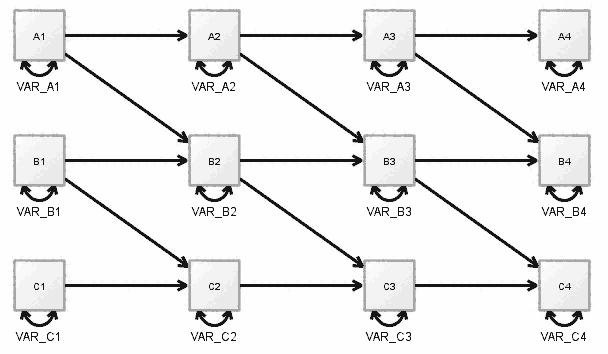
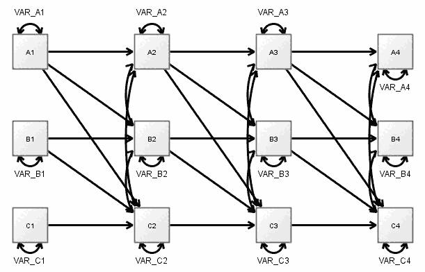

```{r setup, include = FALSE}
knitr::opts_chunk$set(collapse = TRUE, comment = "#>", fig.width = 7,
  fig.height = 4, message = FALSE, warning = FALSE)
```

Most of what psychologists study changes all the time: mood, stress,
fitness, skills, relationships. This article is about why it is worth
modelling how such things change, and why ctsem writes those models in
continuous time. It fits no models, and uses only a little R to compute what
a model implies.

```{r libs}
library(ggplot2)
```

# Questions about change

Does ice cream make people happier? An experiment could give one group ice
cream and another nothing, and ask both how happy they are some time later.
That estimates one effect, at one time after one treatment, in one setting.
To use it anywhere else we need to know more. When does happiness rise, and
for how long? What else changes with it? Does the effect depend on the
amount, the weather or the person? A model of how happiness changes over
time answers these for any time after the treatment, and so carries further
than the single estimate.

Time itself is rarely the interest. It stands for everything that happens as
it passes: after the ice cream come digestion, changes in mood and behaviour,
and other people's responses to them. A model of change over time describes
what tends to follow from a change when nothing else is done.

Effects that pass through other variables take time too. A change in
exercise habits changes fitness, but not within a day. A model of how the
change in habits carries through to fitness over time says when the effect
should show, which a test at one chosen delay cannot.

Such a model can also forecast. It predicts a person's future from their own
past, and from how other, similar people developed. With random effects
ctsem does both. Each person's predictions start from the population and are
refined by their own observations (`ctPredict()`, see
`vignette('ctsem')`).

# Discrete time models

A cross-lagged panel model, or a vector autoregression, describes change as
steps from one occasion to the next. This diagram shows such a model for three
variables over four occasions. A affects B at the next occasion, and B
affects C:



With yearly data, the model says that a change in A takes two years to begin
to affect C. The same model fitted to weekly data says two weeks. Every
coefficient means something different at a different interval, so studies
with different intervals cannot be compared directly, and a study with
unequal intervals does not fit the model at all.

# Change between the occasions

Most constructs exist, and act on each other, between the occasions on which
they are measured as well. A change in exercise begins to affect fitness
straight away, though the effect takes months to show. In a continuous time
model, A drives B and B drives C at every moment. The drift matrix holds
these direct effects, with the effect of each column on each row:

```{r drift}
drift <- matrix(c(
  -1,  0,  0,
   2, -1,  0,
   0,  1, -1), 3, 3, byrow = TRUE,
  dimnames = list(c('A', 'B', 'C'), c('A', 'B', 'C')))
drift
```

The diagonal makes each process return towards its equilibrium after a
change. A has no direct effect on C. The effects across an interval of
$\Delta t$ that a discrete time model would estimate are the matrix
exponential of the drift matrix times the interval. For observations a year
apart:

```{r discrete}
round(expm::expm(drift * 1), 3)
```

A now predicts C a year later, though it has no direct effect on it, because
B changes during the year and A drives that change. Random shocks spread the
same way. Shocks that are independent at each moment become correlated over
a year, because a shock to A moves B and C before the year is out. The
correlations of the residuals across one year, for independent shocks of
equal size:

```{r residuals}
diffusion <- diag(3)
# the stationary covariance solves drift %*% S + S %*% t(drift) + diffusion = 0
S <- matrix(solve(kronecker(diag(3), drift) + kronecker(drift, diag(3)),
  -c(diffusion)), 3, 3)
transition <- expm::expm(drift * 1)
residual <- S - transition %*% S %*% t(transition)
round(cov2cor(residual), 2)
```

To represent this continuous model at a one year interval, a discrete time
model needs every path from each earlier variable to each later one, and
correlated residuals at each occasion:



A model with few direct effects between continuously interacting processes
implies a discrete time model with many lagged effects, at any interval, and
whether the processes are fast or slow.

# The course of an effect

The discrete time effects at each interval are points on a curve. Here is the
response of each process to a change of one unit in A at time 0:

```{r response}
times <- seq(0, 6, by = 0.05)
response <- t(sapply(times, function(t) expm::expm(drift * t)[, 'A']))
course <- data.frame(time = rep(times, 3), process = rep(colnames(drift),
  each = length(times)), response = c(response))
ggplot(course, aes(time, response, colour = process)) +
  geom_line(linewidth = 1) +
  labs(x = 'years since the change in A', y = 'change') + theme_bw()
```

```{r peaks, include = FALSE}
peakB <- times[which.max(response[, 'B'])]
peakC <- times[which.max(response[, 'C'])]
```

A returns towards its equilibrium from the start. B's response is largest
after `r peakB` year, and C's after `r peakC` years. C begins to change at
once, slowly, since the change reaches it only through B. B stays raised for
a while after its peak, and keeps moving C. The lagged effect of A on B or C
in a discrete time model is one point on these curves, chosen by the
interval of the study. For a fitted model, `ctDiscretePars()` plots these
curves with their uncertainty.

# What follows

- A lagged coefficient mixes the direct effect with the indirect ones over
  the interval. The hypothesis that A does not affect C directly is about the
  drift matrix. A discrete time model at the observed interval cannot test
  it, since the lagged effect of A on C is not zero.
- Fixing lagged paths to zero, or shrinking them towards zero with penalties
  or priors to find which effects exist, acts on what the direct effects
  imply after one interval, not on the direct effects.
- A continuous time model states the direct effects, and computes the
  effects for the intervals in the data, equal or not. It does not
  remove the need for observations close enough together to see how the
  processes respond.

ctsem fits discrete time models too, which suit data at a fixed interval
when the interest is in that interval only: see
[Discrete time models](discrete-time.html).
